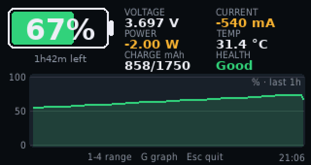
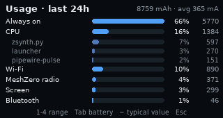

# BattMon

A full-screen battery monitor for the M5Stack **Cardputer Zero**, with live
readings, a history graph, and an estimate of what used the power.

 

## Features

- A large charge gauge that turns green, amber or red with the charge level,
  plus a charging indicator.
- Time to full while charging, or time left on battery.
- Live voltage, current, power, temperature, charge (mAh) and battery health,
  read from the BQ27220 fuel gauge.
- A history graph of charge % or current (mA) over the last 10 min, 1 h, 6 h
  or 24 h.
- A **Usage** screen that estimates where the power went over the last 10 min,
  1 h, 6 h or 24 h: the screen, the CPU (split between the processes that
  used it), Wi-Fi, the MeshZero radio, Bluetooth, and the always-on draw of
  the board itself, in mAh and as a share of the total.
- A small background logger (`battlog.py`, a systemd user service) records a
  sample every 30 s and keeps 48 hours, so the graph and the usage estimate
  have data even when the app isn't open.

## Keys

| Key | Action |
| --- | --- |
| `1`–`4` | time range: 10 min / 1 h / 6 h / 24 h |
| `G` | switch the graph between charge % and current mA |
| `Tab` | switch between the battery and Usage screens |
| `Esc`, `Q`, `Backspace` | quit |

## How it works

`battmon.py` draws with pygame (dummy video driver) straight to the LCD
framebuffer (`/dev/fb0`, 320×170 RGB565). It reads the keyboard from evdev and
the battery from `/sys/class/power_supply/bq27220-0`. It is launched from the
stock APPLaunch launcher through a `.desktop` entry, like the built-in apps.

The logger writes to `~/.local/share/battmon/log.csv` (battery readings)
and `usage.jsonl` (what the system was doing).

### How the usage estimate works

The Cardputer can only measure the **total** battery current; nothing
measures each part separately. So every 30 s the logger records the average
current (sampled every 5 s) together with:

- the screen brightness;
- whether Wi-Fi, Bluetooth and MeshZero are on;
- the CPU load and clock speed;
- the CPU seconds each process used. Python apps are listed by script name,
  kernel threads are grouped as "kernel", and the launcher appears as
  "launcher".

`usage.py` fits a simple model to that history:
`mA = always-on + screen × brightness + Wi-Fi + Bluetooth + MeshZero + CPU × busy cores × GHz`.
It then splits each sample's *measured* current between those parts, so the
totals always match the battery. The CPU's share is divided between
processes by CPU time.

Things to know:

- **These are estimates.** Big items (the screen, the radios, a busy app)
  come out well; small ones are fuzzy.
- **A part needs to change to be measured.** If Wi-Fi was never off, its cost
  can't be told apart from the always-on draw, so a typical value is used and
  it's marked `~`. Flipping things now and then (PowerDeck makes this easy)
  sharpens the estimate. The model learns from the whole 48-hour log.
- **Processes are only charged for CPU time.** Network or radio traffic per
  process can't be measured.
- **Time spent charging is left out.** The current then includes the charge
  going in.

`test_usage.py` checks the model on synthetic data with known costs; it runs
anywhere with numpy.

## Install

You need a Cardputer Zero on the official 64-bit Debian 13 image, reachable
over SSH with passwordless `sudo`. From this folder on your computer, run:

```sh
./install.sh user@cardputer-ip
```

This installs the app to `/opt/battmon`, adds **BattMon** to the launcher,
and enables the `battmon-logger` user service. It uses only the Python,
pygame and numpy that ship on the stock image.
